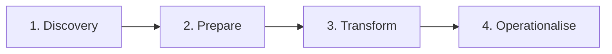

# Four-Phase Transformation Approach

Large goals are broken into workstreams ordered by fastest route to value, with change enablement running through every phase.

## 1. Discovery

- Business and environment readiness
- Application and infrastructure discovery
- Team design
- Gap analysis
- Validate the case for change

## 2. Prepare

- Operating model
- Foundational cloud policies
- Landing zone validation
- Roadmap
- Proofs of concept

## 3. Transform

- Implement the operating model
- Launch the service catalogue
- Automate foundations
- Establish operations
- Build, migrate and integrate
- Validate migration

## 4. Operationalise

- Policy enforcement
- Monitoring and alerting
- Training at scale
- Administration and support ramp-up

## Principles

- Prioritise workstreams by value, capability and dependency, not by organisational chart
- Separate project and business-as-usual teams, with regular impact checks
- Move engagements from resource-based to outcome-based measures wherever possible
