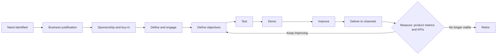

# N-Finite Product Development Loop

A product is never finished until it is retired. The N-Finite loop treats development as a repeating cycle with clear inputs and measurable outputs.

## Inputs

- **Need identification:** customer pull or technology push
- **Business justification:** why this matters commercially
- **Executive sponsorship or stakeholder buy-in**
- **Business requirements**

## Define and engage

Market research, specifications, target market refinement, price points or success definition, and market collateral.

## The loop

Define objectives, test, demo, improve and deliver to channels. Each pass is measured through product metrics and KPIs, from launch through to retirement.

## Who does what

| Function | Contribution |
|---|---|
| Technical and services | Specification and schedule |
| Product management | Loop efficiency, roadmap, cost, communication, quality, risk |
| Pre-sales, sales, marketing, delivery and channel | Differentiation and service usefulness |
| Supply chain | Operations, procurement, channel and vendor relationships |
