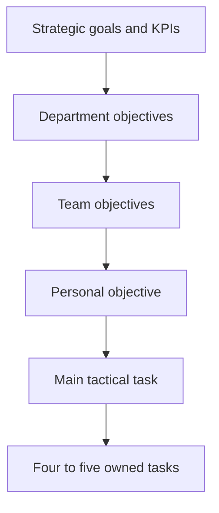

# Objective Cascade

Connects company strategy to the work each person does each week.

## Typical strategic KPIs

Revenue, gross margin, bookings, pipeline growth, recurring revenue conversion.

## How it works

1. Start two levels up: what does my manager's manager need to achieve?
2. Write one personal objective that clearly supports it.
3. Name the main tactical task that moves that objective most.
4. Break it into four or five tasks I own, each with a measure.
5. Review monthly; drop tasks that no longer serve the objective.

## Example structure

| Level | Example |
|---|---|
| Strategic goal | Grow recurring revenue |
| Team objective | Launch two new managed services this year |
| Personal objective | Reduce time from sale to live service |
| Main tactical task | Redesign onboarding and handover |
| Owned tasks | Map the journey; remove steps that add no value; agree readiness gates; train support; track time-to-value |

Example content is illustrative.
